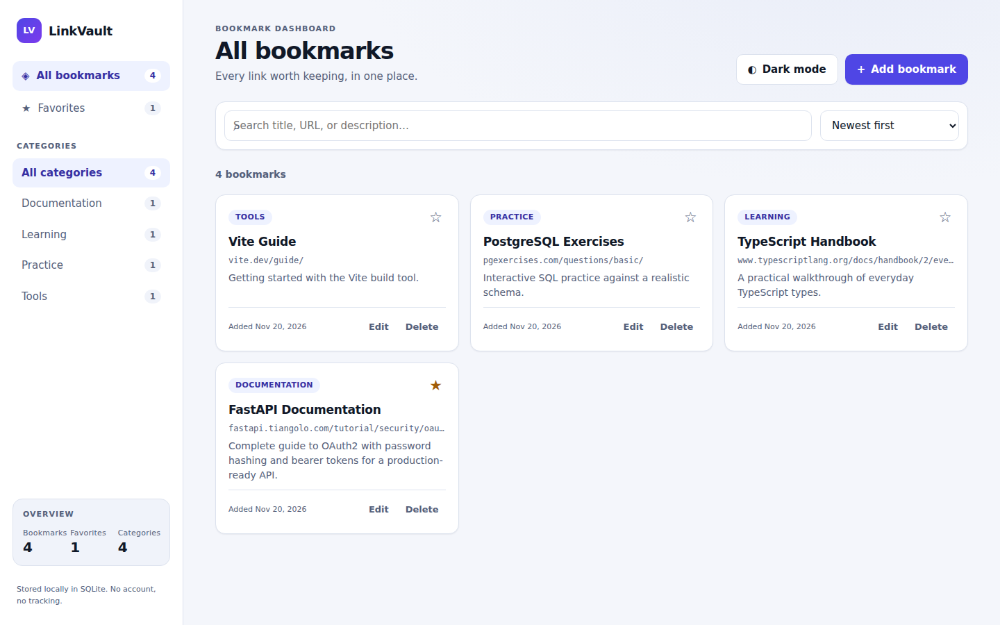
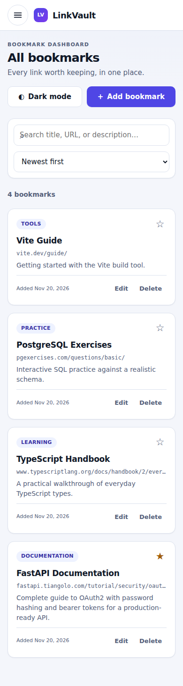
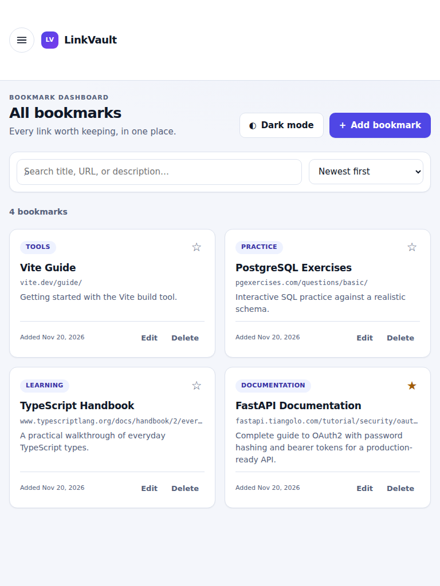
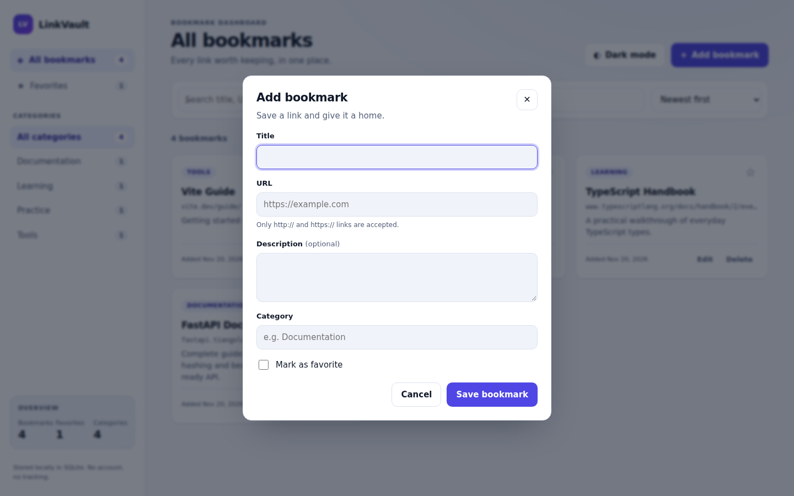

# LinkVault

LinkVault is a responsive bookmark manager for developers, students, and researchers.
Save useful websites, organize them into categories, search across everything you have
saved, mark favorites, and open links safely — all backed by a real FastAPI + SQLite API.



## Features

- Add, edit, and delete bookmarks with title, URL, description, and category.
- Strict URL validation: only absolute `http://` and `https://` URLs are accepted.
  `javascript:`, `data:`, `file:`, `vbscript:`, and other schemes are rejected.
- Full-text search across title, URL, and description.
- Filter by category (case-insensitive) and a dedicated Favorites view.
- Toggle favorites, with live totals for bookmarks, favorites, and categories.
- Sort by newest, oldest, or alphabetical order.
- SQLite persistence with safe initialization and parameterized queries.
- Light and dark themes, remembered in `localStorage` and applied before first paint.
- Loading skeletons, empty states (first use, no matches, no favorites), error state
  with retry, and accessible success/error toasts.
- Responsive layouts checked at 390 px, 768 px, and 1440 px with no horizontal overflow.
- Keyboard-friendly UI: native dialog, visible focus rings, labelled controls,
  semantic landmarks, and `prefers-reduced-motion` support.

### Screenshots

| Mobile (390 px) | Tablet (768 px) | Add dialog |
| --- | --- | --- |
|  |  |  |

## Tech stack

| Area | Tools |
| --- | --- |
| Frontend | HTML5, CSS3, TypeScript (strict), Vite |
| Backend | Python 3.11+, FastAPI, Pydantic v2, SQLite |
| Testing | pytest, Playwright + Chromium, `tsc --noEmit` |
| CI | GitHub Actions |

No UI framework and no runtime third-party JavaScript.

## Project structure

```
LinkVault/
├── backend/
│   ├── main.py           # FastAPI app, routes, error handlers, CORS
│   ├── database.py       # SQLite connection + schema initialization
│   ├── models.py         # Pydantic schemas and URL validation
│   └── requirements.txt
├── frontend/
│   ├── index.html
│   ├── src/
│   │   ├── main.ts       # UI state, rendering, dialogs, theme, navigation
│   │   ├── api.ts        # Typed API client and error handling
│   │   ├── types.ts
│   │   └── styles.css
│   ├── e2e/              # Playwright browser + responsive tests
│   ├── playwright.config.ts
│   ├── vite.config.ts
│   ├── tsconfig.json
│   └── package.json
├── tests/                # pytest suite (temporary SQLite databases)
├── docs/screenshots/
├── .github/workflows/ci.yml
├── LICENSE
└── README.md
```

## Getting started

Prerequisites: Python 3.11+, Node.js 20.19+ (Node 22 recommended).

### 1. Backend

```bash
python3 -m venv .venv
source .venv/bin/activate          # Windows: .venv\Scripts\activate
pip install -r backend/requirements.txt
python3 -m uvicorn backend.main:app --reload --port 8000
```

The API runs at `http://127.0.0.1:8000` (docs at `/docs`). The SQLite file is created at
`backend/linkvault.db` on first start and is ignored by Git.

### 2. Frontend

```bash
cd frontend
npm install
npm run dev
```

Open `http://localhost:5173`. Vite proxies `/api` to the backend, so no frontend
configuration is required.

### Configuration

| Variable | Where | Default | Purpose |
| --- | --- | --- | --- |
| `LINKVAULT_DB` | backend | `backend/linkvault.db` | SQLite file path (tests and e2e use temp files) |
| `CORS_ORIGINS` | backend | localhost/127.0.0.1 on ports 5173 and 4173 | Comma-separated allowed origins |
| `VITE_API_BASE` | frontend | `""` (same origin via proxy) | Absolute API base URL if hosting separately |

## API

| Method | Endpoint | Description |
| --- | --- | --- |
| `GET` | `/api/health` | Service status and version |
| `GET` | `/api/bookmarks` | List/search bookmarks |
| `GET` | `/api/bookmarks/{id}` | Fetch one bookmark |
| `POST` | `/api/bookmarks` | Create a bookmark (`201`) |
| `PUT` | `/api/bookmarks/{id}` | Replace a bookmark's editable fields |
| `DELETE` | `/api/bookmarks/{id}` | Delete a bookmark (`204`) |
| `PATCH` | `/api/bookmarks/{id}/favorite` | Toggle favorite, or set `{"is_favorite": bool}` |
| `GET` | `/api/stats` | Totals and per-category counts |

`GET /api/bookmarks` query parameters:

- `q` — search term matched against title, URL, and description (case-insensitive).
- `category` — exact category, case-insensitive.
- `favorite` — `true` / `false`.
- `sort` — `newest` (default), `oldest`, or `alpha`.

Errors use a consistent shape:

```json
{ "error": { "message": "URL must start with http:// or https://",
             "details": [{ "field": "url", "message": "URL must start with http:// or https://" }] } }
```

## Testing

```bash
# Backend: 32 tests, isolated temporary SQLite databases
python3 -m pytest tests -q

# Frontend: strict typecheck and production build
cd frontend
npm run typecheck
npm run build

# Browser tests: 10 Playwright tests against a production preview + live API
npx playwright install --with-deps chromium
npx playwright test
```

Coverage includes CRUD, URL scheme rejection, validation errors, search
(title/URL/description), wildcard escaping, SQL-injection attempts, category and
favorite filtering, sorting, stats, persistence across restarts, CORS allow-listing,
and concurrent requests.

The Playwright suite covers adding, editing, deleting, favorites, search/filter/sort,
theme persistence, mobile navigation, unsafe URL rejection, link hardening
(`target="_blank"` + `rel="noopener noreferrer"`), and responsive screenshots at the
three target widths.

## Security notes

- The backend has **no authentication** and is intended to run on localhost only.
- Submitted URLs are never fetched or scraped by the server.
- Only absolute HTTP(S) URLs are stored, and the UI re-validates before rendering an
  anchor `href`; external links always use `rel="noopener noreferrer"`.
- All user content is rendered with DOM `textContent`/`textNodes` — never `innerHTML`.
- SQL uses parameterized statements; `LIKE` wildcards in search terms are escaped.
- CORS is restricted to configured local origins.
- SQLite databases, `node_modules`, build output, and test artifacts are git-ignored.

## Known limitations

- No accounts, sharing, or sync — single user, local machine only.
- No pagination; the whole collection is loaded and filtered server-side.
- Categories are created implicitly from bookmarks; there is no separate category manager.
- Optional extras (tags, JSON import/export) are not implemented in v0.1.0.
- Theme preference is per browser; it is not stored on the server.

## License

[MIT](LICENSE)
